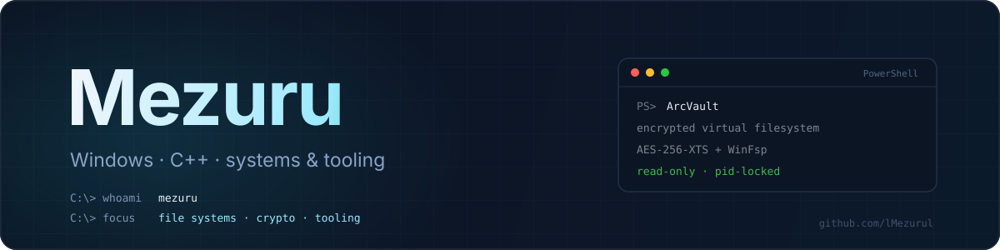
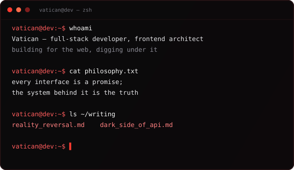
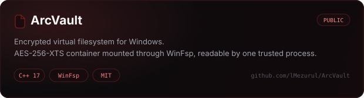
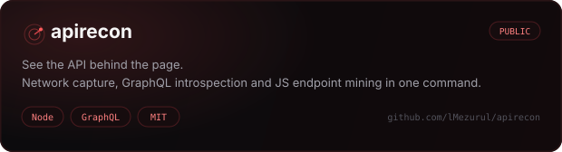

  

  
  

  

## Now

- shipping **ArcVault v1.0** — encrypted virtual filesystem for Windows
- building **apirecon** — see the API behind the page
- writing about systems, APIs and the layers under the interface

## Stack

  

  

  

  
  C / C++ — the low-level corner, when the abstraction gets in the way

## Writing

- **[Reality Reversal](https://vatican-blog.cvv.life/Reality_Reversal)** — a manifesto on surfaces and layers: the interface is what a system shows you, never what it is. Breaking the mechanics down is the only access that actually counts. *(in Russian)*
- **[The Dark Side of API](https://vatican-blog.cvv.life/dark_side_API)** — a long field guide to pulling data out of web apps: undocumented endpoints, GraphQL introspection, headless browsers, mobile traffic, rate limits, proxies and everything that stands between you and the response. *(in Russian)*

## Projects

  

  
  
  

  

  
  
  

